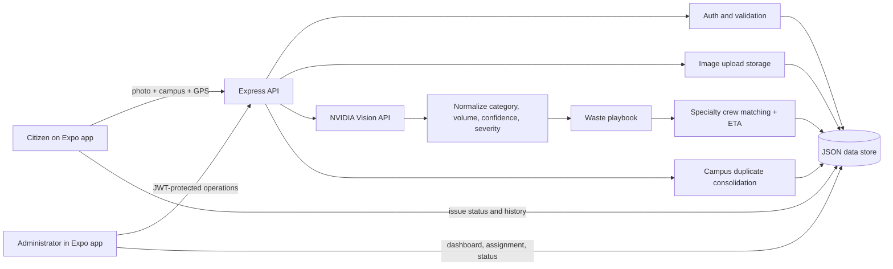

# SwachhLens architecture

This is the source diagram for the implementation. The rendered companion is [`architecture.svg`](./architecture.svg).

## Runtime boundaries

- `mobile/` is an Expo SDK 54 React Native client. It serves both citizen reporting and the administrator operations view.
- `backend/` is a TypeScript Express API. It owns authentication, validation, uploads, AI orchestration, playbook rules, crew assignment, ETA calculations, and persistence.
- `backend/data/` is the demo persistence layer. Writes use a temporary file and rename so JSON records are replaced atomically.
- `backend/uploads/` stores submitted images and is exposed only through the safe `/uploads/:filename` route.
- NVIDIA is the only remote vision provider. A deterministic local fallback keeps the demo usable without a key and marks the result for manual review.
